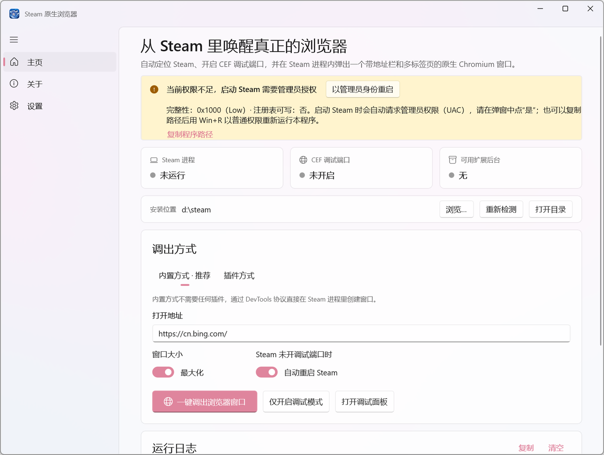
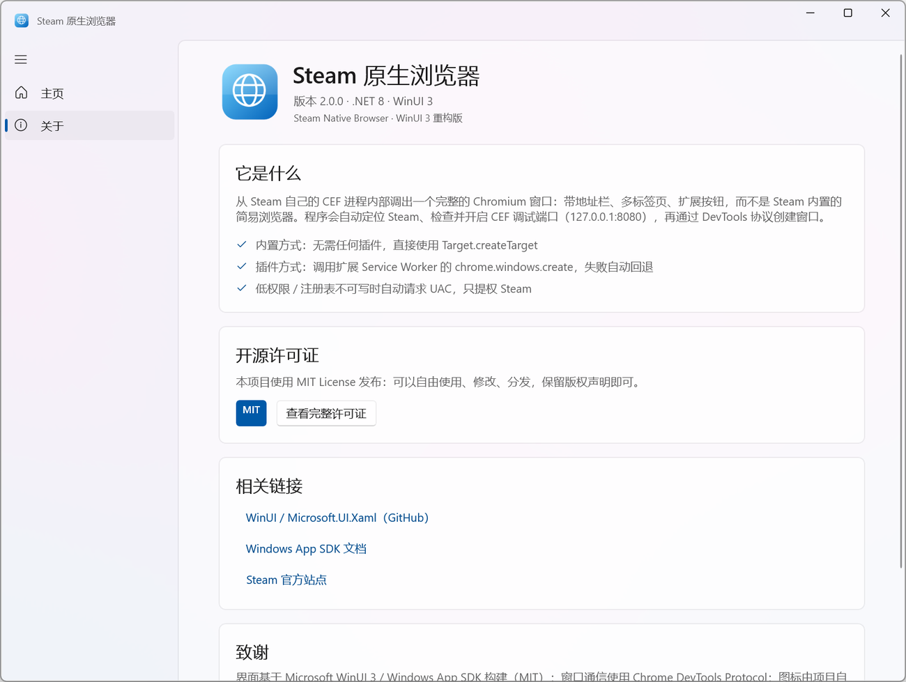
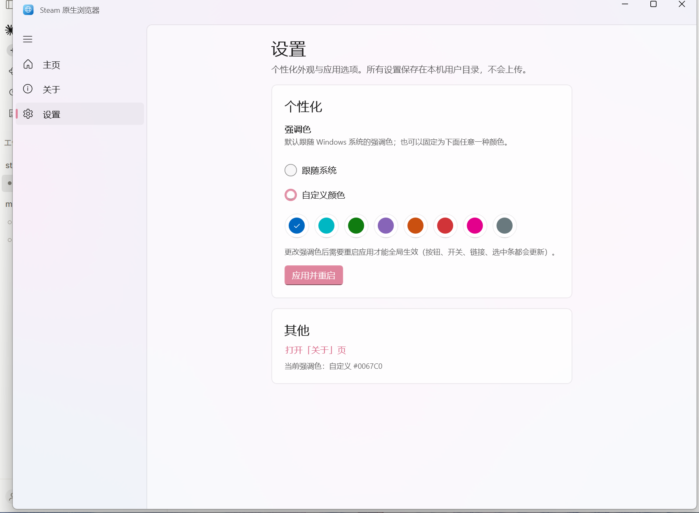
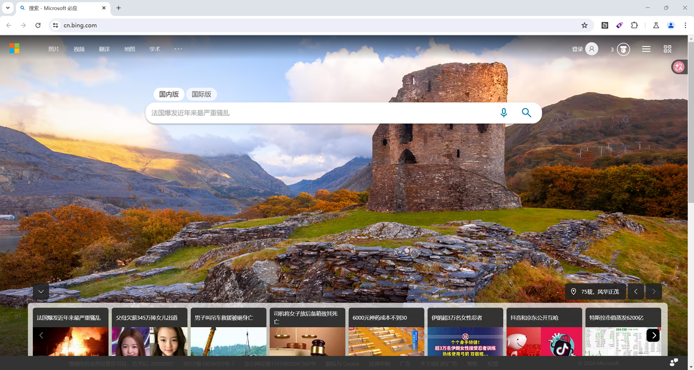

# Steam 原生浏览器

从 **Steam 自己的 CEF 进程内部** 弹出一个完整的 Chromium 窗口（带地址栏、多标签页、扩展按钮），而不是依赖 Steam 内置的简易浏览器。

界面使用 **WinUI 3 / Windows App SDK 1.7** 重构，支持 Mica、Fluent 控件与系统明暗主题；许可证为 **MIT**。









---

## 功能

- **自动定位 Steam**：注册表 `HKCU\Software\Valve\Steam\SteamPath`、`HKLM\...\Valve\Steam\InstallPath`、运行中的 `steam.exe` 路径、常见安装目录、固定磁盘兜底扫描。
- **自动开启 CEF 调试模式**：检测 `127.0.0.1:8080` 是否已是 Steam 的 CEF；若不是，用 `steam.exe -cef-enable-debugging -dev` 启动 Steam（必要时先请求退出）。
- **两种调出方式**：内置方式（无插件）/ 插件方式（扩展 Service Worker），失败自动回退。
- **状态面板**：Steam 进程 / CEF 端口 / 可用扩展后台，每 3 秒自动刷新。
- **权限自适应**：低完整性或注册表不可写时，自动以管理员身份启动 Steam（UAC），并给出诊断与「复制路径」出口。
- **设置页**：强调色默认跟随系统，也可固定为内置 8 种颜色（应用并重启后生效），设置保存在本机。
- **WinUI 3 界面**：Mica 背景、NavigationView、SelectorBar、InfoBar、圆角卡片、Segoe Fluent Icons，含完整「关于」页。

## 两种调出方式

| | 内置方式（推荐） | 插件方式 |
|---|---|---|
| 原理 | 浏览器级 DevTools 协议 `Target.createTarget` | 扩展 Service Worker 里执行 `chrome.windows.create` |
| 依赖 | 无，任何 Steam 版本可用 | 至少一个 MV3 扩展的后台在运行（脚本猫 / 沉浸式翻译 / Google 翻译等） |
| 实测 | ✅ 稳定 | ✅ 可用；后台休眠时给出提示并自动回退到内置方式 |

> 关键结论：**不需要任何插件**。CEF 暴露的 `/json/version` 里带浏览器级 WebSocket 地址，直接发 `Target.createTarget` 就能让 Steam 进程新建一个完整的 Chromium 窗口。

## 系统要求

- Windows 10 1809+ / Windows 11（x64）
- [.NET 8 Desktop Runtime](https://dotnet.microsoft.com/download/dotnet/8.0)
- Windows App SDK **已随程序自包含发布**，无需单独安装运行时
- Steam 已安装并登录过

## 使用

1. 双击 `dist-winui\SteamNativeBrowser.exe`（整个文件夹一起拷贝）。
2. 确认「安装位置」正确（不对就点「浏览…」选 `steam.exe`）。
3. 选择调出方式（默认内置方式），按需填写要打开的地址。
4. 点「一键调出浏览器窗口」。

首次如果 Steam 没开调试端口，程序会自动处理；如果当前进程写不了 Steam 注册表（低权限/沙箱，或键被高权限改写过），会在启动 Steam 时请求 UAC——点“是”即可。

## 权限说明（重要）

`SteamNativeBrowser.exe` 最好以**普通桌面进程（Medium 完整性）**运行。若被聊天工具、沙箱、下载器的“在沙箱中打开”以 **Low 完整性**令牌启动，Windows 的 no-write-up 规则会让它无法写入 `HKCU\Software\Valve\Steam`。

程序会自己识别这种情况：

- 启动时读取完整性级别，并**真实试写一次**注册表；
- 不通过时顶部显示 InfoBar，直接标出 `完整性：0x1000（Low）· 注册表可写：否`；
- 启动 Steam 时自动请求管理员权限（UAC），只提权 Steam，不提权界面；
- 提供「复制路径」，可配合 Win+R 以普通权限重新运行。

## 构建

本机无法访问 NuGet（Schannel TLS 受限）时，使用随仓库提供的 Python 下载器走代理拉包，再离线构建：

```powershell
# 1. 拉取 WinUI 3 依赖（需要 127.0.0.1:7897 可用；脚本使用 Python 的 OpenSSL）
cd E:\Workspace\steam\winui-build
python fetch_nuget.py --out packages microsoft.windowsappsdk=1.7.260224002 `
  microsoft.windows.sdk.buildtools=10.0.22621.756 `
  microsoft.windows.sdk.buildtools.msix=1.7.261008100 `
  microsoft.web.webview2=1.0.2903.40 `
  microsoft.windows.sdk.net.ref=10.0.19041.38

# 2. 构建 / 发布
cd E:\Workspace\steam\SteamNativeLauncher
powershell -File build-winui.ps1
```

说明：

- `src\SteamNativeBrowser.WinUI\NuGet.config` 指向 `..\..\..\winui-build\packages`（离线包）与 `nuget-cache`，路径可按需修改。
- 网络正常时，直接把 `NuGet.config` 换回 nuget.org，执行 `dotnet build` 即可。
- WinUI 3 的 PRI/XAML 工具链需要 `Microsoft.Windows.SDK.BuildTools.MSIX` 包（Visual Studio 未安装时也能用 `dotnet` 构建）。
- 服务层（Steam 定位、CEF 探测、CDP、权限检测）复用了 `src\SteamNativeBrowser\Services`，与 UI 无关。

## 目录结构

```
SteamNativeLauncher/
├─ src/
│  ├─ SteamNativeBrowser.WinUI/      ← WinUI 3 版本（主程序）
│  │  ├─ App.xaml(.cs)               资源、品牌强调色
│  │  ├─ MainWindow.xaml(.cs)        Mica、自定义标题栏、NavigationView
│  │  ├─ Pages/HomePage.xaml(.cs)    状态卡、调出方式、日志
│  │  ├─ Pages/AboutPage.xaml(.cs)   关于页、MIT 许可证弹窗、链接
│  │  └─ LICENSE                     MIT（随程序分发）
│  └─ SteamNativeBrowser/            ← WPF 旧版（保留）
│     ├─ MainWindow.xaml(.cs)
│     ├─ Services/                   ← 两个版本共享的服务层
│     └─ Themes/Controls.xaml
├─ dist-winui/                       ← WinUI 发布产物（自包含 Windows App SDK）
├─ dist/                             ← WPF 旧版单文件 exe
├─ tools/fetch_nuget.py              离线 NuGet 下载器
├─ build-winui.ps1 / build.ps1
├─ LICENSE                            MIT
└─ README.md
```

## 常见问题

**端口 8080 被占用**：程序会识别并提示；请先释放该端口（它必须是 Steam CEF，UA 含 `Valve Steam Client`）。

**插件方式找不到后台**：MV3 扩展的 Service Worker 会休眠。程序会尝试唤醒；仍失败会自动回退内置方式。

**出现「Steam 注册表路径当前不可写」**：v1.2 起已兜住，不会再让 Steam 以错误权限启动。看 InfoBar 里的完整性级别：
- `0x1000 (Low)`：从聊天工具/沙箱入口启动的，点「一键调出」并在 UAC 点“是”，或复制路径用 Win+R 运行；
- `0x2000 (Medium)` 但注册表不可写：`HKCU\Software\Valve\Steam` 被高权限进程改写过，同样用 UAC 提权启动 Steam。

**窗口打不开 / 空白**：先用「打开调试面板」访问 `http://localhost:8080` 确认 CEF 正常；地址栏换一个可访问的站点再试。

## 许可证

[MIT](LICENSE) © 2026 SteamNativeLauncher contributors

界面基于 Microsoft WinUI 3 / Windows App SDK（MIT）构建；窗口通信使用 Chrome DevTools Protocol；图标由 `tools/make-icon.ps1` 生成。

## 说明与风险

- 本工具会修改 Steam 的启动参数并可能重启 Steam；请自行确认没有未保存的 Steam 内操作。
- `-cef-enable-debugging` 会在本机开放无鉴权的调试端口 8080，本机任意程序都能连接；不需要时请用正常方式启动 Steam。
- 调出的窗口属于 Steam 的 CEF，不是系统安装的 Chrome，登录状态 / 书签 / 密码与 Chrome 无关。
- 仅用于本机自用与学习研究。
