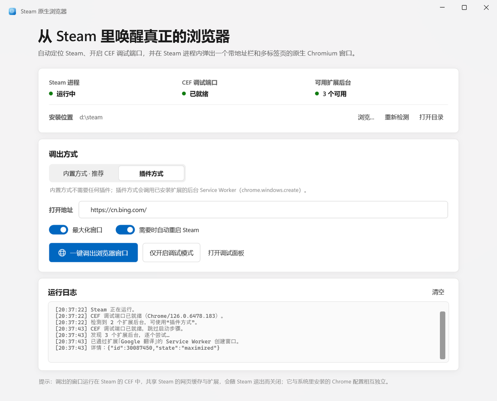
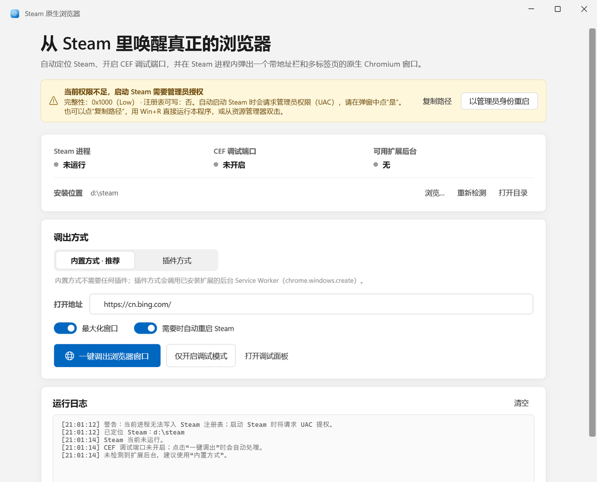

# Steam 原生浏览器启动器

从 **Steam 自己的 CEF 进程内部** 弹出一个完整的 Chromium 窗口（带地址栏、多标签页、扩展按钮），而不是依赖 Steam 内置的简易浏览器。




---

## 功能

- **自动定位 Steam**：注册表 `HKCU\Software\Valve\Steam\SteamPath`、`HKLM\...\Valve\Steam\InstallPath`、运行中的 `steam.exe` 路径、常见安装目录、各固定磁盘兜底扫描。
- **自动开启 CEF 调试模式**：检测 `127.0.0.1:8080` 是否已是 Steam 的 CEF；若不是，用 `steam.exe -cef-enable-debugging -dev` 启动 Steam（必要时先请求退出再启动）。
- **一键调出窗口**：两种方式任选，效果一致。
- **状态面板**：Steam 进程 / CEF 端口 / 可用扩展后台，3 秒自动刷新。
- **Windows 11 Fluent 风格**：Mica 背景（不可用时自动回退纯色）、自绘标题栏、圆角卡片、Fluent 分段选择器 / 开关 / 滚动条、Segoe UI Variable + 微软雅黑。

## 两种调出方式

| | 内置方式（推荐） | 插件方式 |
|---|---|---|
| 原理 | 浏览器级 DevTools 协议 `Target.createTarget` | 扩展 Service Worker 里执行 `chrome.windows.create` |
| 依赖 | 无，任何 Steam 版本可用 | 至少一个 MV3 扩展的后台在运行（如脚本猫、沉浸式翻译、Google 翻译） |
| 实测 | ✅ 稳定 | ✅ 可用；后台休眠时给出提示并自动回退到内置方式 |

> 关键结论：**不需要任何插件**。CEF 暴露的 `/json/version` 里带浏览器级 WebSocket 地址，直接发 `Target.createTarget` 就能让 Steam 进程新建一个完整的 Chromium 窗口。

## 系统要求

- Windows 10 1809+ / Windows 11（x64）
- [.NET 8 Desktop Runtime](https://dotnet.microsoft.com/download/dotnet/8.0)（当前发布的是框架依赖单文件 exe，约 350 KB）
- Steam 已安装并登录过

## 使用

1. 双击 `dist\SteamNativeBrowser.exe`。
2. 确认「安装位置」正确（不对就点「浏览…」选 `steam.exe`）。
3. 选择调出方式（默认内置方式），按需填写要打开的地址。
4. 点「一键调出浏览器窗口」。

首次如果 Steam 没开调试端口，应用会提示并自动重启 Steam（可关闭「需要时自动重启 Steam」开关改为手动处理）。

## 工作原理

```
┌─────────────────────────────┐
│ Steam.exe                   │
│  └─ steamwebhelper.exe      │  ← CEF (Chrome/126)
│       ├─ 127.0.0.1:8080     │  ← /json/version, /json/list
│       └─ 新建的 Chromium 窗口 │
└─────────────────────────────┘
              ▲
              │ WebSocket / CDP
       SteamNativeBrowser.exe
```

- 内置方式：`GET /json/version` → 取 `webSocketDebuggerUrl` → 发 `Target.createTarget {url, newWindow:true, windowState:"maximized"}`。
- 插件方式：`GET /json/list` → 找 `type=service_worker` 的 `chrome-extension://…` → 连接后在 Console 上下文执行 `chrome.windows.create({url, type:"normal", state:"maximized"})`。
- 所有窗口都属于 `steamwebhelper.exe`，共享 Steam 的 `htmlcache` 配置与已装扩展，Steam 退出时窗口一起关闭。

## 构建

无需联网（项目零 NuGet 依赖，仓库内置 `NuGet.config` 清空源）：

```powershell
dotnet build src\SteamNativeBrowser\SteamNativeBrowser.csproj -c Release
# 发布单文件 exe 到 dist\
powershell -File build.ps1
```

自包含发布（需要能访问 NuGet 下载 runtime pack）：

```powershell
dotnet publish src\SteamNativeBrowser\SteamNativeBrowser.csproj -c Release -r win-x64 `
  --self-contained true -p:PublishSingleFile=true -o dist
```

## 权限说明（重要）

`SteamNativeBrowser.exe` 需要以**普通桌面进程（Medium 完整性）**运行，才能替你把 Steam 拉起来。

如果它被聊天工具、沙箱、下载器的“在沙箱中打开 / 打开文件”以 **Low 完整性**令牌启动，Windows 的 no-write-up 规则会让它无法写入 `HKCU\Software\Valve\Steam`；Steam 继承这个令牌后就会弹「Steam 注册表路径当前不可写」。

v1.2 起程序会自己识别这种情况：

- 启动时读取自己的完整性级别，并**真实试写一次**注册表；
- 不通过时顶部显示黄色提示条，直接标出 `完整性：0x1000（Low）· 注册表可写：否`，方便判断是“启动方式不对”还是“注册表键被改坏”；
- **启动 Steam 时自动请求管理员权限（UAC），只提权 Steam，不提权界面**；点“是”后 Steam 就能正常写入并开启 CEF；
- 提示条上还有「复制路径」，可以配合 Win+R 直接以普通权限运行本程序（多数情况下更干净，不需要 UAC）。



> 如果 Steam 已经以调试模式在运行，「一键调出」不需要任何权限，直接可用。

## 常见问题

**端口 8080 被占用**：应用会识别并提示；请先释放该端口（它必须是 Steam CEF，UA 含 `Valve Steam Client`）。

**插件方式找不到后台**：MV3 扩展的 Service Worker 会休眠。应用会尝试用扩展页面发消息唤醒；仍失败会自动回退内置方式。

**Steam 以管理员身份运行**：应用会检测能否写 Steam 注册表；不能写时自动以管理员身份启动 Steam（UAC）。

**出现「Steam 注册表路径当前不可写」**：v1.2 已把这一步兜住——不再让 Steam 以错误权限启动。看到黄色提示条时：

1. 看提示条里的 `完整性`：`0x1000 (Low)` 表示当前 exe 是从聊天工具/沙箱入口启动的，换成资源管理器双击，或直接点「一键调出」并在 UAC 点“是”；
2. `0x2000 (Medium)` 但 `注册表可写：否` 表示 `HKCU\Software\Valve\Steam` 被高权限进程改写过（这个键的 Owner 是 `BUILTIN\Administrators`），同样用 UAC 提权启动 Steam 即可；
3. 提示条上的「复制路径」可配合 Win+R 直接以普通权限运行。

**窗口打不开 / 空白**：先用「打开调试面板」访问 `http://localhost:8080` 确认 CEF 正常；地址栏换一个可访问的站点再试。

## 目录结构

```
SteamNativeLauncher/
├─ src/SteamNativeBrowser/
│  ├─ MainWindow.xaml(.cs)        界面与交互
│  ├─ Themes/Controls.xaml        Win11 Fluent 样式
│  ├─ Services/SteamLocator.cs    查找 Steam
│  ├─ Services/SteamCef.cs        CEF 探测 / 目标枚举
│  ├─ Services/SteamCefController.cs  自动开启调试模式
│  ├─ Services/DevToolsClient.cs  极简 CDP WebSocket 客户端
│  ├─ Services/SteamWindowLauncher.cs 两种调出方式
│  ├─ Interop/                    Mica / 窗口圆角 / 最大化边界
│  └─ Assets/app.ico
├─ tools/make-icon.ps1            生成图标
├─ dist/SteamNativeBrowser.exe    发布产物
├─ build.ps1
└─ NuGet.config
```

## 说明与风险

- 本工具会修改 Steam 的启动参数并可能重启 Steam；请自行确认没有未保存的 Steam 内操作。
- `-cef-enable-debugging` 会在本机开放无鉴权的调试端口 8080，本机任意程序都能连接；不需要时请用正常方式启动 Steam。
- 调出的窗口属于 Steam 的 CEF，不是系统安装的 Chrome，登录状态 / 书签 / 密码与 Chrome 无关。
- 仅用于本机自用与学习研究。
